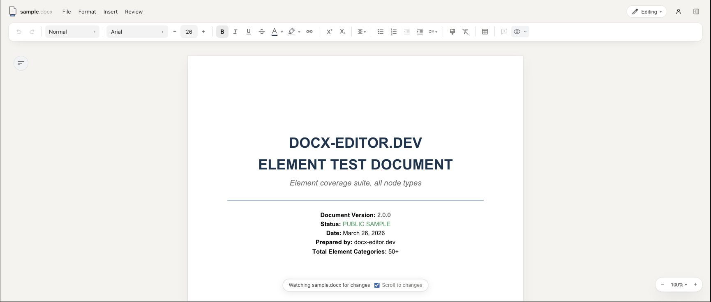

# docx-editor MCP App

<p align="center">
  <a href="https://modelcontextprotocol.io/"></a>
  <a href="https://github.com/eigenpal/docx-editor-mcp-app/blob/main/LICENSE"></a>
  <a href="https://www.docx-editor.dev/docs"></a>
</p>

Preview and edit Word documents beside your conversation in ChatGPT, Codex, and Claude.
Use the official plugin free, including for business documents.
You need no separate Pro subscription for this use.

Your agent edits the `.docx` with its own document tools.
The preview follows local file changes and highlights changed paragraphs.
You can also edit in the preview and save to the same file.

Eigenpal builds this plugin and the [DOCX Editor library](https://www.docx-editor.dev/).
Use the plugin to try the editor in your document workflow.
To add Pro features to your product, see [commercial licensing](https://www.docx-editor.dev/commercial-license).
The editor core remains available under Apache-2.0.



Editor preview in the local test harness, captured on October 27, 2026.
The harness emulates the host file viewer; this image does not show a desktop directory installation.

## Installation status

As of October 27, 2026, this repository is public, but no GitHub release is published.
The `stable` marketplace branch does not exist yet.
The npm registry returns `404` for `@docx-editor.dev/mcp-app`.
Directory approval remains pending in the [publication record](docs/submission/publication-status.md).

For now, use the source build below to evaluate the plugin.
After publication, use the [release installation guide](docs/releases.md).

### Build for local evaluation

Install Bun, Node.js 22 or later, and the Codex CLI before you start.
The `setup codex` command supports macOS and Linux.

```bash
git clone https://github.com/eigenpal/docx-editor-mcp-app.git
cd docx-editor-mcp-app
bun install --frozen-lockfile
npm pack
npm install -g ./docx-editor.dev-mcp-app-*.tgz
docx-editor-mcp-app setup codex
```

`npm pack` builds the package before it creates the archive.
Install the archive so the host receives the package without development dependencies.
For Claude Desktop, use `docx-editor-mcp-app setup claude` instead of `setup codex`.
Finish your running tasks, then restart the desktop app.

The source license permits changes to the MCP app.
After an official release, its covered Pro version also permits limited internal source builds for personal and business use.
Read the [contributor license guidance](CONTRIBUTING.md#understand-the-component-licenses) before distributing a modified build.

## How it works

The app exposes one tool to the model: `open_document`.
The agent uses its own document tools to change the file.

| Mode               | Where the server runs        | File access                                                                      |
| ------------------ | ---------------------------- | -------------------------------------------------------------------------------- |
| Local plugin       | Your computer                | Opens local paths, follows file changes, and saves edits.                        |
| Hosted plugin      | An HTTPS service             | Receives document bytes; does not open local paths or follow local file changes. |
| OpenAI file viewer | Through the host integration | Uses the host's file API where available.                                        |

Local installation includes a small Node.js server and the editor assets.
Your desktop host starts the server automatically.
You do not start a separate website or open a local HTTP port.

The editor processes documents inside the host's browser view.
The widget receives its assets through MCP in both local and hosted modes.
It does not load the editor website.
The local plugin does not send documents to Eigenpal servers.
Your host and model provider can process document data under their own policies.

You can deploy the existing HTTP server behind your website's HTTPS endpoint.
A static website alone cannot provide this MCP integration.
See [local and hosted deployment](docs/hosting.md) for requirements and tradeoffs.

## Use it

1. Ask the agent to show a file, for example: "Open ~/report.docx."
2. Select **Open editor** to see the full editor.
3. Ask for changes, for example: "Shorten the executive summary."
   Your agent edits the file with its own tools.
   The preview updates when the local file changes.

If both versions change, choose whether to reload the file or keep your version.

Other commands:

- `docx-editor-mcp-app stdio` runs the server over stdio. Hosts start it this way.
- `docx-editor-mcp-app http --port 3000` serves MCP at `http://localhost:3000/mcp`.

## Build local directory packages

Prepare the ChatGPT plugin ZIP and Claude desktop extension from the same local build:

```bash
bun run build:local
bun run smoke:packages
```

The archives appear in `dist/local-packages/`.
Both include the server, editor assets, WebAssembly file, and license notices.
The host starts the server over stdio.
You do not host the editor or run a public endpoint.

See the [directory submission guide](docs/submission/README.md) for installation tests and directory submission requirements.
OpenAI requires approval for local MCP submissions.
Claude reviews desktop extensions through its extension submission process.

You can still use `http` for a separate deployment that needs a remote MCP endpoint.
The local directory packages do not use that mode.

## Develop

```bash
bun install
bun run build:harness
bun run dev
```

Open `http://localhost:3000/__harness/host.html` to use the harness.
Use it to test file updates and conflicts without a desktop app.
It uses an MCP Apps host and emulates the OpenAI file viewer.

Before you push, run:

```bash
bun run typecheck
bun run lint
bun run test
bun run build
bun run smoke
bun run format
```

See [CONTRIBUTING.md](CONTRIBUTING.md) for contribution guidelines and
[SECURITY.md](SECURITY.md) to report a vulnerability.

## Troubleshoot

### The preview does not finish loading

Run `setup codex` or `setup claude` again, then restart your desktop app.
Finish running tasks before you restart.

### The plugin does not appear in ChatGPT

Run `codex plugin list` and check for `docx-editor@docx-editor`.
Then restart ChatGPT.

### Page layout differs from Word

Check that the preview loaded `harfbuzz.wasm`.
Report engine layout problems in [eigenpal/docx-editor](https://github.com/eigenpal/docx-editor/issues).

### A file does not open

Use a `.docx` file no larger than 15 MB.
Provide an absolute path for local mode or `content_base64` for hosted mode.

## Support and policies

See the [plugin page](https://www.docx-editor.dev/mcp-app) for product details.
Read the [support guide](https://www.docx-editor.dev/mcp-app/support),
[privacy policy](https://www.docx-editor.dev/mcp-app/privacy),
and [terms of use](https://www.docx-editor.dev/mcp-app/terms).

## License

The MCP app source uses [Apache-2.0](LICENSE).
Apache-2.0 does not cover the proprietary Pro components, including Pro code inside combined bundles.

The proprietary bundled Pro components have additional host permission in [LICENSE-PLUGIN.md](LICENSE-PLUGIN.md).
You may use the official plugin free in ChatGPT, Codex, and Claude, including for business documents.
You need no separate Pro subscription for this use.
You may not reuse those Pro components in another product without a separate EigenPal Pro License.
Your documents remain yours.

Open-source editor components retain their Apache 2.0 terms.
You may embed those components in commercial products under their own licenses.
The complete bundled plugin does not use a single open-source license.
The built package lists dependency terms in `THIRD_PARTY_NOTICES.md`.

For commercial support, email [docx-editor@eigenpal.com](mailto:docx-editor@eigenpal.com).
